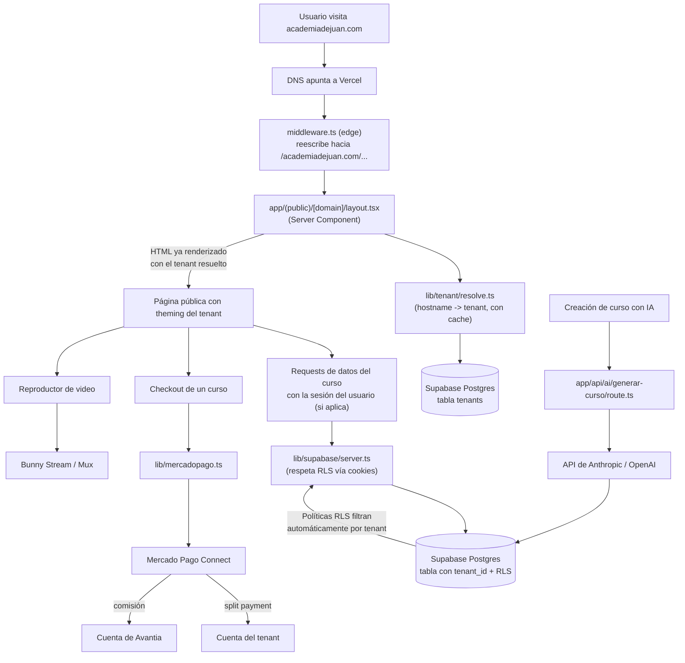
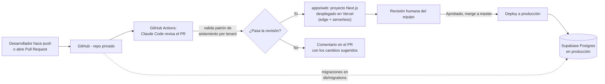

# Estructura de Código y Arquitectura Técnica — Avantia

> Stack: **Next.js (App Router) + TypeScript**, monorepo con npm workspaces
> (un único proyecto en `apps/web`).
> Ver [decisiones/002-vuelta-a-nextjs.md](../decisiones/002-vuelta-a-nextjs.md)
> para la razón de volver a Next.js respecto a la versión intermedia
> (Node.js + Express + React).
> Ver [Supuestos_y_Pendientes.md](Supuestos_y_Pendientes.md) para qué de este
> documento es firme y qué sigue provisional o sin resolver.

## 1. Estructura de carpetas del proyecto

```
avantia/
├── apps/
│   └── web/                          # Next.js (App Router) + TypeScript
│       ├── src/
│       │   ├── middleware.ts         # PIEZA CLAVE: corre en el edge, decide
│       │   │                         # panel vs. sitio público según el
│       │   │                         # hostname, antes de cualquier render
│       │   ├── app/
│       │   │   ├── layout.tsx        # layout raíz (html/body)
│       │   │   ├── (dashboard)/      # Panel interno: donde el dueño de cada
│       │   │   │   │                 # academia administra su cuenta
│       │   │   │   ├── layout.tsx
│       │   │   │   ├── page.tsx              # resumen
│       │   │   │   ├── cursos/
│       │   │   │   │   ├── page.tsx
│       │   │   │   │   ├── nuevo/page.tsx    # creación de curso (flujo con IA)
│       │   │   │   │   └── [cursoId]/page.tsx
│       │   │   │   ├── estudiantes/page.tsx
│       │   │   │   └── configuracion/
│       │   │   │       ├── dominio/page.tsx  # conectar dominio propio del tenant
│       │   │   │       └── marca/page.tsx    # logo, colores, theming
│       │   │   │
│       │   │   ├── (public)/         # Sitio público de cada academia
│       │   │   │   └── [domain]/     # segmento real: recibe el hostname que
│       │   │   │       │             # reescribe middleware.ts
│       │   │   │       ├── layout.tsx        # resuelve el tenant (Server
│       │   │   │       │                     # Component) y aplica theming
│       │   │   │       ├── page.tsx          # landing de la academia
│       │   │   │       ├── curso/[slug]/page.tsx     # venta de un curso
│       │   │   │       ├── aprender/[cursoId]/[leccionId]/page.tsx
│       │   │   │       └── checkout/page.tsx
│       │   │   │
│       │   │   └── api/              # Route handlers (reemplazan a Express)
│       │   │       ├── webhooks/
│       │   │       │   └── mercadopago/route.ts
│       │   │       ├── ai/
│       │   │       │   └── generar-curso/route.ts
│       │   │       ├── tenants/
│       │   │       │   ├── route.ts          # POST: alta de tenant
│       │   │       │   └── resolve/route.ts  # GET: usado por Client Components
│       │   │       └── health/route.ts
│       │   │
│       │   ├── components/
│       │   │   ├── ui/               # componentes genéricos reutilizables
│       │   │   └── tenant/           # componentes que aplican el theming
│       │   │                         # dinámico de cada academia
│       │   │
│       │   ├── lib/
│       │   │   ├── supabase/
│       │   │   │   ├── server.ts     # cliente por-request (Server Components/
│       │   │   │   │                 # route handlers), respeta RLS vía cookies
│       │   │   │   ├── client.ts     # cliente del navegador (Client Components)
│       │   │   │   └── admin.ts      # service role — SOLO server, bypassa RLS
│       │   │   ├── tenant/
│       │   │   │   └── resolve.ts    # hostname -> tenant (con cache)
│       │   │   ├── tenantContext.tsx # expone el tenant ya resuelto a los
│       │   │   │                     # Client Components del sitio público
│       │   │   ├── mercadopago.ts
│       │   │   └── ai/
│       │   │       └── generarCurso.ts   # lógica de prompting contra la API del LLM
│       │   └── types/
│       │       └── tenant.ts
│       └── next.config.ts
│
├── db/
│   ├── migrations/                   # migraciones versionadas de Postgres
│   └── schema.sql                    # definición de tablas + políticas RLS
│
├── docs/                             # documentación del proyecto
│
├── .github/
│   └── workflows/
│       └── pr-review.yml             # Claude Code revisando cada PR
│
└── package.json                      # workspaces raíz del monorepo
```

### Por qué esta forma y no otra

- **Un único proyecto Next.js** sirve panel, sitio público y API desde el
  mismo codebase: las funciones serverless/edge de Next.js reemplazan al
  servicio Express separado que tenía la versión intermedia del stack.

- **`middleware.ts` es el corazón del multi-tenancy**: corre en el edge, en
  cada request, y decide entre las dos familias de rutas según el hostname
  (`academiadejuan.com` / `juan.avantia.app` -> sitio público;
  `app.avantia.app` o `localhost` -> panel). Para el sitio público, reescribe
  el pathname hacia el segmento real `[domain]` (los route groups
  `(dashboard)` y `(public)` no agregan segmento a la URL, así que hace
  falta un segmento real para que Next.js pueda distinguir cuál renderizar).
  A propósito **no** consulta la base de datos ahí: eso sería costoso en
  cada request de edge.

- **`app/(public)/[domain]/layout.tsx` resuelve el tenant contra Supabase**,
  ya en runtime Node.js (Server Component), y llama a `notFound()` si el
  hostname no corresponde a ningún tenant. Esta es la pieza que le devuelve
  al proyecto el SSR que se había perdido en la versión Node + React: el
  HTML de las páginas de venta sale con el contenido y el theming del tenant
  ya resueltos, sin esperar a que cargue JavaScript en el navegador.

- **Dos clientes de Supabase en el servidor, a propósito:** `server.ts` usa
  la sesión del usuario autenticado vía cookies (con `@supabase/ssr`) y
  respeta las políticas de Row-Level Security (así un profesor de un tenant
  nunca puede leer datos de otro tenant aunque haya un bug en el código de
  la app, porque la base de datos misma lo bloquea). `admin.ts`, con service
  role, existe aparte y separado justamente para que sea imposible usarlo
  por error en una parte del código donde no corresponde — por ejemplo,
  `lib/tenant/resolve.ts` lo necesita porque resolver el tenant de un
  hostname es una operación que por definición no puede filtrarse por
  `tenant_id` de antemano. Ninguno de los dos se importa nunca desde un
  Client Component.

---

## 2. Diagrama de arquitectura — flujo de una request



---

## 3. Diagrama de despliegue — del commit a producción



---

## 4. Multi-tenancy con Next.js: cómo se resuelve

1. `apps/web/src/middleware.ts` corre en el **edge**, en cada request, y
   decide según el hostname si la request es para el panel
   (`app/(dashboard)`) o para el sitio público de un tenant — en ese caso
   reescribe el pathname hacia `app/(public)/[domain]`, pasando el hostname
   como parámetro de ruta.
2. `app/(public)/[domain]/layout.tsx` resuelve el tenant real contra
   Supabase (Server Component, runtime Node.js) y devuelve 404
   (`notFound()`) si el hostname no corresponde a ninguna academia.
3. El tenant resuelto se expone a los Client Components descendientes (ej.
   el reproductor de video) vía `lib/tenantContext.tsx`, sin necesidad de un
   segundo fetch en el navegador — a diferencia de la versión SPA, donde
   `tenantContext.tsx` tenía que pedirlo por HTTP después de montar.

**Ganancia frente a Node + React puro:** las páginas públicas de venta de
cursos (`LandingPage`, `CursoVentaPage`) se renderizan en servidor, con el
contenido y el theming del tenant ya en el HTML inicial — mejor SEO, sin el
delay de loading que tenía la versión SPA.

---

## 5. Notas para la implementación

- `middleware.ts` corre en cada request, así que debe ser liviano: no
  consulta la base de datos, solo hostname -> reescritura de path.
  `lib/tenant/resolve.ts` (que sí consulta Supabase) corre en el layout,
  runtime Node.js, y cachea en memoria el resultado por hostname (TTL de
  60s) para no pegarle a la base de datos en cada render.
- Las políticas RLS de `db/schema.sql` son la última línea de defensa, pero
  como quedó definido antes, no hay que confiar solo en ellas: cada consulta
  desde `lib/supabase/server.ts` debería además filtrar explícitamente por
  `tenant_id` a nivel de aplicación.
- El route handler `app/api/ai/generar-curso/route.ts` es el único punto de
  la app que llama a la API del LLM — mantenerlo centralizado ahí facilita
  controlar costos y cambiar de proveedor (Anthropic/OpenAI) sin tocar el
  resto del código. Pendiente: derivar el tenant de la sesión del usuario
  logueado en vez de recibirlo en el body (ver TODO en el archivo).
- El frontend (Client Components) nunca debe usar `lib/supabase/admin.ts`:
  toda operación con service role vive exclusivamente en Server Components y
  route handlers.

## 6. Lado del alumno en el sitio de la academia (ADR 018, Aceptada)

- **Cuentas:** `alumnos(tenant_id, correo, password_hash, …)`, único por academia; no usan `auth.users`. Contraseña con scrypt (`lib/alumno/password.ts`).
- **Sesión:** cookie `av_alumno` httpOnly emitida solo en el host de la academia, validada contra `alumno_tokens` (hash SHA-256) y el `tenant_id` del host. Es independiente de la sesión del panel (ADR 003).
- **Acceso a datos:** `lib/alumno/*` es el único código del sitio público que usa `supabaseAdmin`; todas sus queries filtran por el tenant del host. El creador ve `alumnos`, `inscripciones` y `pagos` con su sesión y RLS (sin `password_hash`, por grants de columnas).
- **Inscripción:** `pendiente → activa | rechazada | vencida`. Las invitaciones del creador activan solo con correo confirmado; el resto espera la activación del creador (pago manual en `pagos`) o, a futuro, la pasarela.
- **Rutas del alumno** (`app/(public)/[domain]`): `/`, `/curso/[slug]`, `/registro`, `/ingresar`, `/recuperar`, `/restablecer`, `/confirmar`, `/mis-cursos`, `/progreso`, `/aprender/[cursoId]` y `/aprender/[cursoId]/[leccionId]`, `/aprender/[cursoId]/completado`.
- **XP y niveles:** derivados del progreso (`lib/alumno/xp.ts`), sin tabla propia. La liberación por fecha (ADR 004) se valida en el servidor (`lib/alumno/liberacion.ts`).
- **Redirecciones en el sitio de la academia:** no usar `redirect()` dentro de Server Actions (Next resuelve el destino sin la reescritura host → `[domain]` del middleware y entrega 404). Las acciones devuelven `irA` y `FormAccion`/`useIrA` navegan con `window.location.assign`. Tampoco llamar `revalidatePath` en esas acciones: re-pinta la página y desmonta el formulario antes de navegar.
- **Pruebas E2E:** `apps/web/e2e` (Playwright). `npm run dev` y `npm run test:e2e`; `E2E_TENANT` (por defecto `prueba`) y `E2E_PORT`. Para muchos ingresos desde una IP: `ALUMNO_LIMITE_FACTOR=50` al levantar el servidor (multiplica los limitadores de registro, ingreso y correos).

## Identidad visual por academia (ADR 027, migración 0014)

`tenants` suma `tipografia` (`clasico`, `moderno`, `cercano`, `editorial`) y `forma` (`recta`, `suave`), ambas con `check` y default que reproduce la apariencia anterior. Es configuración del tenant: no hay tablas nuevas y la RLS (`tenants_update_propio`) y los índices por `tenant_id` existentes cubren el cambio. Se lee en servidor desde el host (`resolveTenantByHostname`, `getSitioAcademia`) y se escribe solo desde el panel con sesión (`guardarAparienciaAction`, validación de lista cerrada en `aparienciaSchema`); nunca del body.
**Orden de despliegue:** aplicar la migración 0014 **antes** de desplegar el código, porque `resolveTenantByHostname` y `getSitioAcademia` seleccionan las columnas nuevas.

## Módulos enriquecidos y edición por módulo (ADR 029, F1, migración 0015)

`modulos` suma `descripcion` (≤600), `objetivos text[]` (máx. 4, «Qué aprenderás») y `duracion_min` (1–1.440); `lecciones` suma `descripcion` (≤400) y `duracion_min`. Todo es opcional y **no bloquea la publicación**. No hay tablas nuevas (la RLS y los índices por `tenant_id` existentes cubren el cambio); los materiales llegan con la F2 (migración 0016). Validación server-side en `lib/creador/validacion.ts` (`descripcionModulo`, `descripcionLeccion`, `objetivosModulo`, `duracionMin`), escritura en `lib/creador/estructura.ts` (`actualizarModulo`, `actualizarLeccion`) y acción `actualizarModuloAction`, siempre con el tenant de la sesión.

**Materiales (F2, migración 0016):** tabla `materiales` (`tenant_id`, `curso_id`, `modulo_id`, `leccion_id` opcional, `titulo`, `url` https o nula mientras está incompleto, `tipo` documento|enlace, `nota` ≤200, `orden`). Claves foráneas compuestas `(modulo_id|leccion_id, tenant_id)` con borrado en cascada, RLS en las 4 operaciones por `auth_tenant_id()` e índice `(tenant_id, modulo_id, orden)`; `check` de https en la base. `leccion_id` nulo = material del módulo. Repo en `lib/creador/materiales.ts` (valida con `validarUrlMaterial`, comprueba que la lección sea del mismo módulo y tenant, tope de 10 por módulo), acciones en `actionsEditor.ts` y editor `EditorMateriales` (sección «Materiales del módulo» y bloque dentro de cada lección). Los alumnos los verán desde la F3.

**Archivo en lecciones de tipo documento (ADR 030, migración 0018):** `lecciones` suma `archivo_nombre` y `bytes` y reutiliza `storage_path` y `contenido_tipo` (MIME); un `check` impone que con archivo la lección sea de tipo documento y no tenga `contenido_url`. El bucket y sus políticas son los mismos. `lib/creador/archivos.ts` sirve a materiales y a lecciones con la misma lógica (URL firmada de subida, verificación del tamaño real en el bucket, ruta {tenant}/{curso}/{uuid}, un objeto por destino) y la **cuota de 100 MB suma ambos**. El editor de la lección ofrece «Enlace / Subir archivo» solo con el formato Documento ya guardado; cambiar de formato, quitar el archivo o pegar un enlace con archivo presente borran el objeto o lo impiden. El alumno abre el archivo por `GET /aprender/[cursoId]/leccion/[leccionId]/archivo` (sesión, inscripción activa, lección liberada, URL firmada de 60 s); `catalogo.ts` anula `storagePath` en lo que ve el alumno y deja `archivoNombre`. `limpiezaArchivos.ts` también quita los archivos de las lecciones al borrar lección, módulo o curso.

**Vista del alumno (F3):** `lib/alumno/materiales.ts` lee con service role y `tenant_id` explícito, y entrega al alumno solo `MaterialAlumno` (sin `storage_path`; las reglas puras están en `materialesReglas.ts`). La lección muestra descripción, duración y «Materiales» (los de la lección y los del módulo, solo los completos); la ficha pública del curso muestra la presentación de cada módulo pero **no** los materiales. Los archivos se abren por `GET /aprender/[cursoId]/material/[materialId]`: `exigirCursoActivo` (sesión + inscripción activa), material del mismo tenant y curso, lección o módulo liberado (`puedeAbrirMaterial`), y recién entonces redirección 302 a una URL firmada de 60 s con `Cache-Control: no-store`. Al borrar una lección, un módulo o un curso, `limpiezaArchivos.ts` quita del bucket los objetos que la cascada de la base deja huérfanos.

**Archivos propios como material (ADR 030, migración 0017):** `materiales` suma `origen` (enlace|archivo), `storage_path`, `archivo_nombre`, `mime` y `bytes` (check de coherencia: con archivo no hay `url`). Bucket **privado** `materiales` (tope 25 MB y lista de tipos en el propio bucket), ruta `{tenant_id}/{curso_id}/{uuid}.{ext}`, políticas de `storage.objects` por carpeta de tenant. Flujo en `lib/creador/archivos.ts`: `prepararSubida` (valida tipo, tamaño y cuota de 100 MB por academia y emite URL firmada de subida) → el navegador sube directo a Storage, tras comprimir imágenes a WebP (`lib/creador/comprimir.ts`) → `confirmarSubida` (lee el tamaño real del objeto, reaplica la cuota y valida que la ruta sea del tenant y curso). Reglas puras compartidas en `archivosReglas.ts`. El creador abre su archivo con URL firmada de 60 s; la lectura del alumno se emite en la F3.

**Editor:** el Paso 3 es una lista de módulos (`PasoEstructura`); cada módulo se abre en `/cursos/[cursoId]/modulos/[moduloId]` (`EditorModulo`: presentación, lecciones con `EditorLecciones`, quiz). La página es un server component que carga el curso del tenant y responde 404 si el módulo no pertenece a él. Las migas y «Volver a los módulos» regresan a `/cursos/[cursoId]/editar?paso=estructura`.
